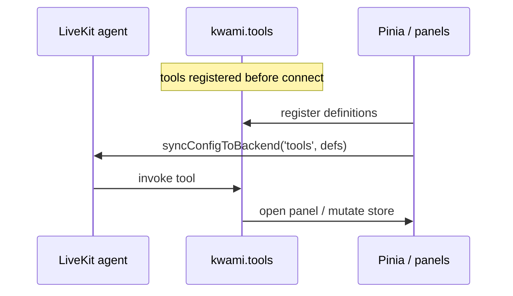

# Tools

The LiveKit agent can invoke **client tools** registered on `kwami.tools`. This app registers a workspace-oriented set in [`useWorkspaceAgentTools.ts`](../../src/composables/useWorkspaceAgentTools.ts).

Definitions are synced **every connect**. Registration happens before the room opens; connect is the reliable point to tell the backend what the UI can execute.

The app registers its tools through `registerToolBatch()`
([`src/lib/toolRegistration.ts`](../../src/lib/toolRegistration.ts)), not one
`kwami.registerTool()` at a time: the SDK sends the whole list to a live agent on every
call, and the app re-registers all of its ~100 tools on every language switch. A batch
fills the registry and the dispatch table and syncs **once**.

## What tools can do

High-level domains (see `UI_CONTROL_DOMAINS` and `WORKSPACE_PANELS` in the composable):

- Open / size panels (settings and apps), including aliases (`energy` → `credits`, `inbox` → `email`)
- Theme, avatar, scene, voice, enhancements
- Soul and models
- Email compose / inbox filters
- Calendar events
- Transcription / history
- Reset avatar / theme / scene
- Memory recall — list and forget memories, jump between conversations, clear the transcript ([`useRecallAgentTools.ts`](../../src/composables/useRecallAgentTools.ts))
- Companion admin — create, rename and delete kwamis, read the credit balance, sign out, randomize appearance ([`useKwamiAdminAgentTools.ts`](../../src/composables/useKwamiAdminAgentTools.ts))
- Extras — export / import a theme, read and reset performance metrics, create a wallet ([`useWorkspaceExtrasAgentTools.ts`](../../src/composables/useWorkspaceExtrasAgentTools.ts))

Copy for tool names and errors is in `workspaceAgentTools.locale.ts`.

## Registering a new tool set

A `use*AgentTools` composable is only reachable if `registerInto()` in
[`useWorkspaceAgentTools.ts`](../../src/composables/useWorkspaceAgentTools.ts) calls its
`register*` function, after a `group('…')` line that files its tools for the Tools panel
(a test fails if an app tool is left in `other`). Those last three domains spent three releases written, translated and
unit-tested but never registered — 19 tools the model was never told about, with nothing
failing anywhere. `tests/unit/toolRegistrars.test.ts` now fails if a composable defines a
registrar that nothing calls.

A client tool also needs a matching capability block in `kwami-lk-agent`
(`agent/src/domain/capabilities.py`), or the agent will not reach for it however well it is
described here.

Names and schemas have to suit every model provider: a name of letters, digits and
underscores starting with a letter, at most 64 characters, and `parameters` as an object
schema with a schema per property. A provider that refuses one tool refuses the whole
request — every turn of the session — so the agent skips such a tool with a warning.

## Server vs client

| Kind         | Runs        | Examples                                   |
| ------------ | ----------- | ------------------------------------------ |
| Client tools | Browser     | Open Memory panel, set accent, draft email |
| Server tools | Agent / API | Web search, memory write, outbound SMS     |

Web search results arrive as data-channel messages and are shown by `useSearchResults` / `SearchOrbitCards`. Browser-use sessions emit `kwami:browser_session` and open `BrowserPanel`.

## The model's budget

The model takes at most **128 tools** per request: the agent's built-ins (47 with every
credential), the app's ~100 and whatever the user added. The agent trims client tools from the
tail and reports the outcome in a `tool_inventory` data message (see `docs/protocol.md` in
`kwami-lk-agent`), which the Tools panel shows as a budget and as a "Does not reach the model"
mark on each tool left out. User tools are kept at the **front** of the registry
(`moveToolsToFront`) so the trim keeps them; app groups other than *Interface* can be switched
off per kwami to make room (`userTools.disabledGroups`).

## Tools the user adds

The Tools panel has four tabs: **Catalog**, **Create**, **MCP** and **Test**.

- **Webhook tools** ([`src/lib/userTools.ts`](../../src/lib/userTools.ts)): name, description,
  GET or POST address with `{param}` path placeholders, and parameters built as rows (the JSON
  Schema is generated, never typed). They are checked as they are typed, saved on the kwami's
  config (`tools.webhooks`) and called with a plain `fetch` — never the user's Kwami token —
  so the service must allow the app's origin (CORS). Templates call free, keyless APIs that do.
- **MCP servers** ([`src/lib/mcpClient.ts`](../../src/lib/mcpClient.ts)): the SDK's own MCP
  client is a placeholder that lists nothing, so the app speaks MCP over Streamable HTTP itself
  (`initialize`, `tools/list`, `tools/call`, JSON or SSE answers, `Mcp-Session-Id`). A
  server is saved on the kwami (`tools.mcpServers`) only once it has connected, reconnected on
  load, and each of its tools can be switched off. Tools are exposed as `server__tool`, with
  their input schema reduced to what every provider accepts. API keys never go in the config:
  memory, or `localStorage` when the user asks. Servers on the older HTTP+SSE transport are
  not supported.
- **Test** runs any registered tool through the handler the agent would reach, with a form
  built from its schema.
