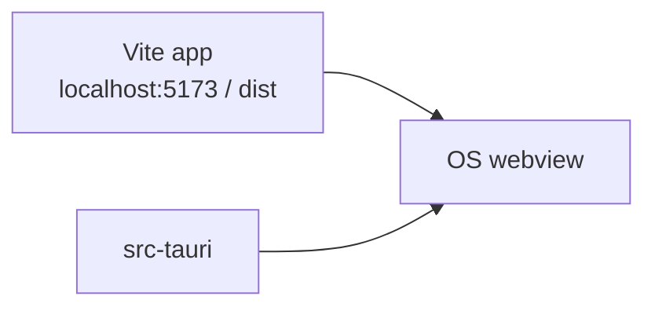

# Desktop (Tauri)

Kwami App can run as a native window via [Tauri 2](https://v2.tauri.app/). The frontend is the same Vite app; Rust only hosts the webview.



## Layout

```
src-tauri/
├── Cargo.toml
├── tauri.conf.json
├── build.rs
├── tauri.release.conf.json
├── capabilities/{default,kwami-io}.json
├── icons/
└── src/main.rs
```

[`tauri.conf.json`](../../src-tauri/tauri.conf.json):

| Field | Value |
| --- | --- |
| Product name | `kwami-app` |
| Identifier | `com.tauri.dev` (development only; the installer uses its own) |
| Dev URL | `http://localhost:5173` |
| `beforeDevCommand` | `bun run dev` |
| `beforeBuildCommand` | `bun run build` |
| `frontendDist` | `../dist` |
| Window | 800×600, title `KWAMI` |

## Run

Install the [Tauri 2 prerequisites](https://v2.tauri.app/start/prerequisites/) for your OS (WebView2 on Windows, WebKitGTK on Linux, Xcode CLT on macOS). Then:

```bash
bun run tauri dev
```

## The Windows installer

Account → Install offers two separate things: the PWA (installed by the browser) and this native app (`public/downloads/KWAMI-setup.exe`, served by the same deploy as the button). Other systems see a note instead of a button, because only Windows has an installer so far.

[`tauri.release.conf.json`](../../src-tauri/tauri.release.conf.json) is merged over `tauri.conf.json` for this build:

| Field | Value | Why |
| --- | --- | --- |
| `frontendDist`, window `url` | `https://kwami.io` | The window shows the live site, so it matches kwami.io and needs no rebuild for frontend changes. A bundled frontend would run at `http://tauri.localhost`, which the API's CORS does not accept |
| `identifier` | `io.kwami.desktop` | Its own data folder and single-instance lock, apart from `tauri dev` |
| `app.security.capabilities` | `["kwami-io"]` | With a remote `frontendDist` kwami.io counts as local, so without this list `default.json` would apply to it too |

[`capabilities/kwami-io.json`](../../src-tauri/capabilities/kwami-io.json) grants only what sign-in needs: the deep link back and opening a web address in the system browser. Everything else from the site is refused.

To rebuild it, on Windows, and commit the result:

```bash
bun run desktop:installer
```

Good to know:

- The installer is unsigned, so Windows SmartScreen warns on first run. The button's note explains the way past it.
- It installs per user, without administrator rights, and registers `kwami://`. `tauri dev` registers the same scheme each time it starts, so with both on one PC a sign-in returns to whichever registered last.
- Cloudflare refuses files over 25 MiB, and the script checks that. This one is about 2.4 MB because no frontend is inside.
- Unknown paths fall back to the app's HTML on Cloudflare, so a missing file would download a web page: `tests/unit/nativeInstall.test.ts` fails if the file is not there.

## Webview constraints

The HTTP client avoids `AbortSignal.any` and composes abort signals itself. Linux Tauri uses WebKitGTK, which historically lagged Chromium on that API.

`vite-plugin-pwa` still builds a service worker; it is unused in the desktop webview and harmless.

## Before bundling the frontend instead

- Add the app's origin (`http://tauri.localhost` on Windows) to the API's `CORS_ORIGINS`
- Set CSP in `tauri.conf.json` (`csp` is currently `null`)
- Do not embed secrets; a bundled binary uses the `VITE_*` values baked in at build time
